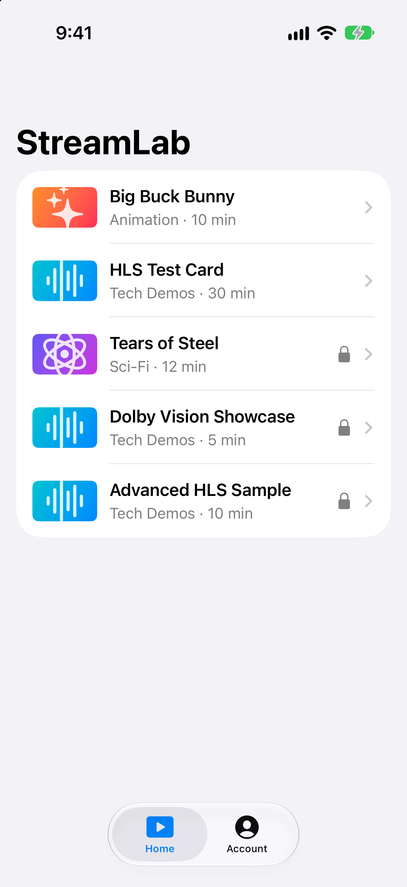
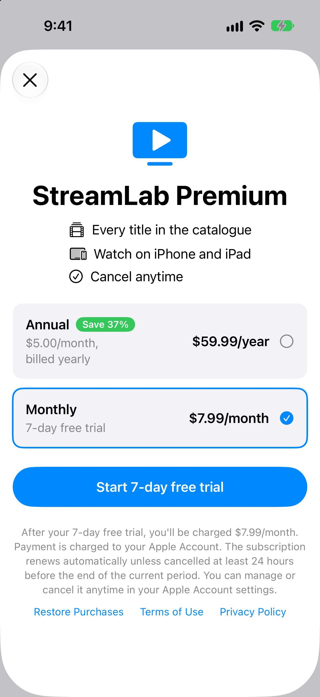
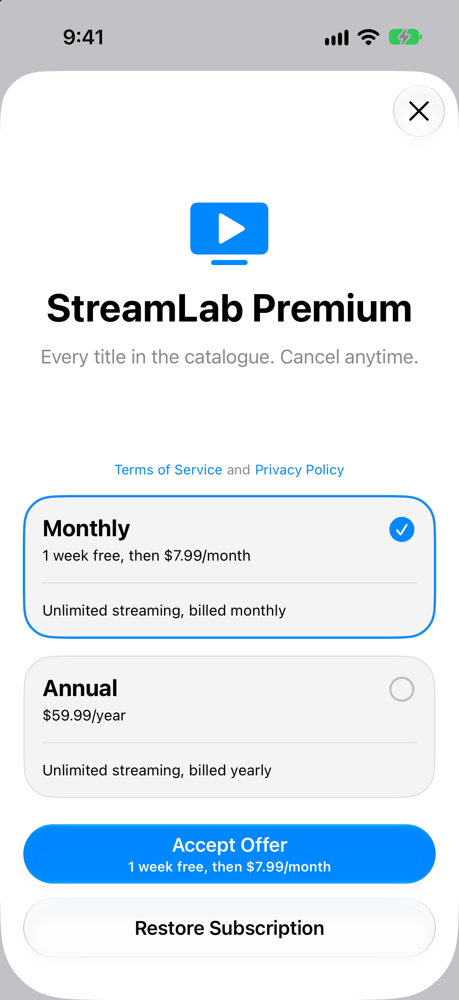
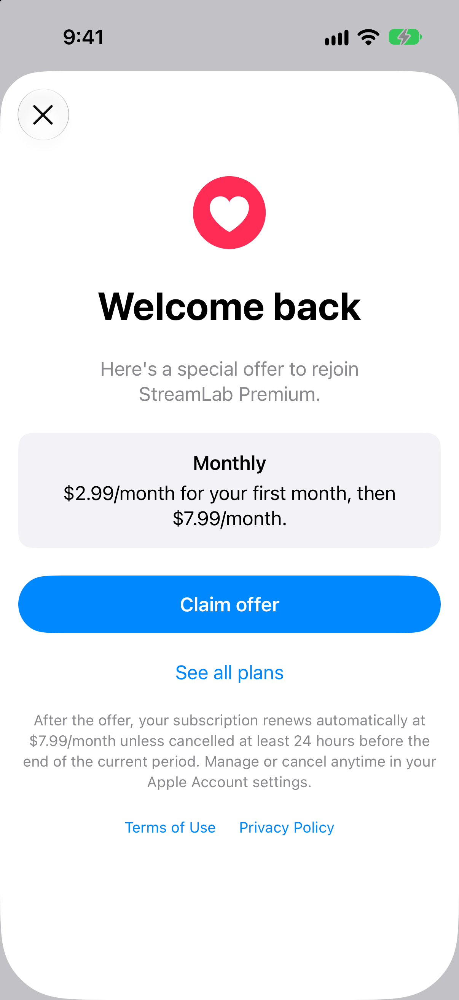
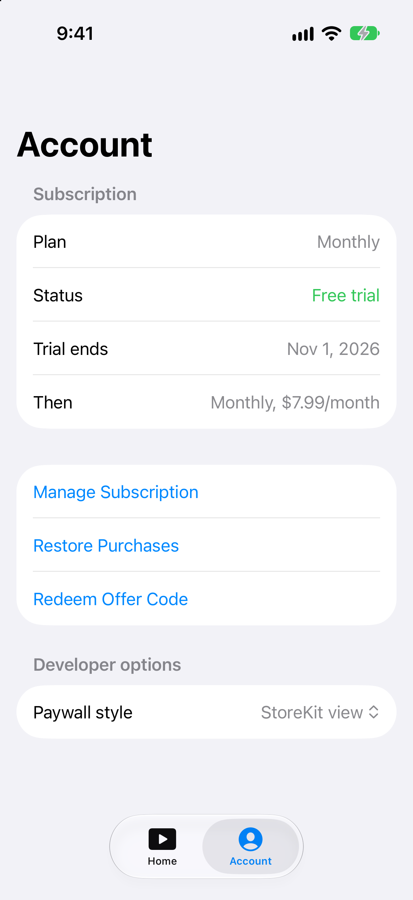

# StreamLab

A SwiftUI video streaming app built to practise **StoreKit 2 subscriptions** end to end: a paywall with monthly and annual auto-renewable plans, a free-trial introductory offer, entitlement gating, renewals and refunds, in-app subscription management, win-back offers, App Store Review Guideline 3.1 compliance, and an `SKTestSession` test suite.

Free titles play for everyone. Premium titles unlock with a StreamLab Premium subscription.

## Screenshots

<table>
  <tr>
    <td></td>
    <td></td>
    <td></td>
    <td></td>
    <td></td>
  </tr>
  <tr>
    <td align="center">Home</td>
    <td align="center">Custom paywall</td>
    <td align="center">StoreKit paywall</td>
    <td align="center">Win-back offer</td>
    <td align="center">Account</td>
  </tr>
</table>

## Features

| Area | What the app does | Where |
|---|---|---|
| Products | Loads both plans with `Product.products(for:)`, sorted by price, using StoreKit's localized `displayPrice` | [`SubscriptionStore.swift`](StreamLab/SubscriptionStore.swift) |
| Purchase | Handles success, cancelled and pending results, verifies every transaction, and calls `finish()` after delivering | [`SubscriptionStore.swift`](StreamLab/SubscriptionStore.swift) |
| Entitlements | Access comes only from `Transaction.currentEntitlements`. Nothing about the subscription is stored by the app | [`SubscriptionStore.swift`](StreamLab/SubscriptionStore.swift) |
| Renewals and refunds | A `Transaction.updates` listener starts at launch; `Product.SubscriptionInfo.Status.updates` and a scheduled refresh at the expiry date cover status changes | [`SubscriptionStore.swift`](StreamLab/SubscriptionStore.swift) |
| Free trial | 7-day free trial on Monthly, shown only when `isEligibleForIntroOffer` is true | [`PaywallView.swift`](StreamLab/PaywallView.swift) |
| Two paywalls | A custom SwiftUI paywall and Apple's `SubscriptionStoreView`, switchable in a debug-only setting. Both use one purchase pipeline | [`PaywallView.swift`](StreamLab/PaywallView.swift), [`StoreKitPaywallView.swift`](StreamLab/StoreKitPaywallView.swift), [`PaywallStyle.swift`](StreamLab/PaywallStyle.swift) |
| Win-back offers | Lapsed subscribers see a $2.99 first month back, using `eligibleWinBackOfferIDs` and the `.winBackOffer` purchase option (iOS 18) | [`WinBackOfferView.swift`](StreamLab/WinBackOfferView.swift) |
| Account | Plan, trial, renewal or cancellation date, plan switches, billing problems, Manage Subscription (`manageSubscriptionsSheet`), Restore Purchases (`AppStore.sync()`), Redeem Offer Code | [`AccountView.swift`](StreamLab/AccountView.swift) |
| Gating | One access rule, `canWatch(isPremium:)`, used by the list, detail screen and player. The player closes if access is revoked mid-playback | [`VideoDetailView.swift`](StreamLab/VideoDetailView.swift), [`PlayerView.swift`](StreamLab/PlayerView.swift) |
| Catalogue | Fetched from [`catalog.json`](catalog.json) with `URLSession` and `Codable`, cached in SwiftData so it works offline | [`CatalogRepository.swift`](StreamLab/CatalogRepository.swift) |

## Plans

Defined in [`StreamLab.storekit`](StreamLab/StreamLab.storekit), one subscription group, **StreamLab Premium**:

| Plan | Product ID | Price | Offers |
|---|---|---|---|
| Monthly | `com.akshay.StreamLab.premium.monthly` | $7.99/month | 7-day free trial (introductory); $2.99 first month back (win-back) |
| Annual | `com.akshay.StreamLab.premium.annual` | $59.99/year | None |

Both plans share a service level, so switching between them is a crossgrade that takes effect at the next renewal.

## App Store Review Guideline 3.1

Every screen where someone can subscribe shows:

- the billed price and period as the most prominent price
- what happens after the free trial or offer
- automatic renewal and how to cancel
- links to the [Terms of Use](https://www.apple.com/legal/internet-services/itunes/dev/stdeula/) and [Privacy Policy](PRIVACY.md)
- Restore Purchases (on the paywall and in Account)

Prices always come from StoreKit, never from hardcoded strings. Ineligible offers are hidden, not greyed out. The paywall shows a retry state if products can't load. Cancellation goes through Apple's own subscription management sheet.

## Architecture

```
StreamLabApp
 ├─ SubscriptionStore (@Observable, @MainActor)   all StoreKit access
 │    ├─ Transaction.updates listener
 │    ├─ Status.updates listener + expiry timer
 │    └─ purchase → process → verify → refresh → finish
 ├─ SwiftData ModelContainer (CachedVideo)
 └─ RootView (tabs)
      ├─ HomeView ─ VideoDetailView ─ PlayerView
      │                 └─ PaywallSheet → PaywallView / StoreKitPaywallView / WinBackOfferView
      └─ AccountView
```

- **One store object** owns StoreKit. Views read its state and never call StoreKit directly.
- **Entitlements are never persisted.** They're rebuilt from StoreKit at launch and on every update.
- **Cache-then-network catalogue**: the list reads SwiftData through `@Query`; the repository fetches the JSON and upserts records.

## Requirements

- Xcode 27
- iOS 18.0 or later (win-back offers need iOS 18)
- No App Store Connect account: purchases run against the local StoreKit configuration file

## Running

1. Open `StreamLab.xcodeproj`.
2. Check **Product > Scheme > Edit Scheme > Run > Options > StoreKit Configuration** is set to `StreamLab.storekit`.
3. Run on an iPhone simulator. Purchases are free and instant.
4. Use **Debug > StoreKit > Manage Transactions** to refund, cancel, or delete purchases.

To try a win-back offer, set the renewal rate to **Monthly Renewal Every 5 Minutes** (`"_timeRate" : 13` in the `.storekit` file), subscribe, cancel in Account, wait for it to expire, then open the paywall. Set it back to Real Time (`0`) afterwards.

## Tests

[`SubscriptionStoreTests.swift`](StreamLabTests/SubscriptionStoreTests.swift) runs 11 tests against the same StoreKit configuration with `SKTestSession`: product loading, purchase with free trial, simulated purchase failure, Ask to Buy approval, refunds, purchases from outside the app, renewals, cancellation, restore, and a lapse into a win-back offer using an accelerated time rate.

Run them with **Cmd+U** on an iOS 27 simulator (the test target's minimum version).

## Credits

- [Big Buck Bunny](https://peach.blender.org) and [Tears of Steel](https://mango.blender.org) © Blender Foundation, licensed under [CC BY 3.0](https://creativecommons.org/licenses/by/3.0/). Streams hosted by [Mux](https://test-streams.mux.dev) and [Unified Streaming](https://demo.unified-streaming.com).
- HLS test streams from [Apple's HTTP Live Streaming examples](https://developer.apple.com/streaming/examples/).

StreamLab is a personal portfolio project and isn't published on the App Store.
